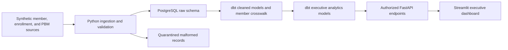

# Health Benefit Lens Architecture

Status: planned architecture, not implemented infrastructure.

## Processing Rules

- Preserve raw inputs and record source, event ID, and receipt time.
- Resolve source member IDs through an explicit crosswalk.
- Evaluate coverage against a claim's service date.
- Prevent duplicate events and repeated reversals from changing totals twice.
- Recompute affected results after late events and coverage corrections.
- Keep valid business exceptions visible separately from malformed records.
- Aggregate each dataset at its intended grain before combining metrics.

## Access Boundaries

Use separate database roles for ingestion, transformation, and analytics reads.
The dashboard accesses aggregate reporting through the API. The API must enforce
permissions server-side and must not use a database superuser. Executive users
must not be able to retrieve raw identity records. Record access decisions
without copying sensitive payloads into application logs.

## Update Target

Start with scheduled incremental processing. The initial target is no more than
60 seconds from event receipt to dashboard availability for the demo workload.
Measure source freshness and processing latency separately. This is a target,
not a verified performance claim.

## First Implementation

Implement the deterministic fixture generator and meaningful business-rule
tests before setting up the database. Dependencies will be managed inside this
project, independently of other projects on the development machine.
